 

**CSE student · researcher · builder, based in Ahmedabad.**
 
I work on agentic AI, and on teaching deep learning to run on tiny hardware.

 

 

## Pick a door

My portfolio comes in two moods. Same person, different universe.

|  | **The Crimson Horizon** | **The Cosmic Builder** |
| :-- | :-- | :-- |
| **Mood** | Dark, cinematic, 3D | Warm, cosmic, hand-drawn |
| **Enter** | [**Open →**](https://cosmic-blunder.vercel.app/anushka-horizon_6_4) | [**Open →**](https://cosmic-blunder.vercel.app/) |

 

## Right now

- Interning as an **AI/ML engineer** at TechTrinetra7
- Writing about **edge AI** for resource-constrained devices
- Building agents that know when to hand things back to a human

 

*The rest of the story lives on the portfolio.*

[**cosmic-blunder.vercel.app**](https://cosmic-blunder.vercel.app/)

